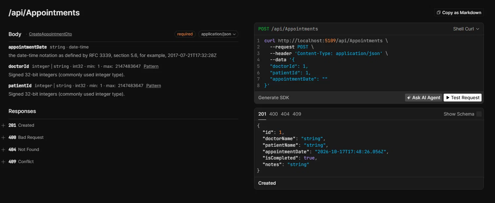

# ClinicConnect API

A REST API for managing doctors, patients and appointments in a small clinic.
Built with ASP.NET Core and Entity Framework Core as a learning project, with a focus on
clean layering, predictable error handling and automated tests.

## Features

- CRUD-style management of doctors and patients (list, get by id, create, delete)
- Appointment scheduling with business rules (see below)
- Completing an appointment with doctor's notes
- Consistent error responses in the standard Problem Details format
- Interactive API documentation (OpenAPI + Scalar) in the Development environment

## Tech stack

.NET 10, ASP.NET Core (controllers), Entity Framework Core 10 with SQLite,
xUnit, OpenAPI (`Microsoft.AspNetCore.OpenApi`) and Scalar.

## Getting started

Requirements: [.NET 10 SDK](https://dotnet.microsoft.com/download).

```bash
git clone https://github.com/Czerniej/ClinicConnect.git
cd ClinicConnect
dotnet run --project src/ClinicConnectApi
```

The SQLite database is created automatically: pending EF Core migrations are applied on startup.
Open the interactive documentation at `http://localhost:5109/scalar`
(the port is printed in the console; the documentation is available only in the Development environment).

Run the tests:

```bash
dotnet test
```



## API overview

| Resource | Endpoints |
|---|---|
| Doctors | `GET /api/doctors`, `GET /api/doctors/{id}`, `POST /api/doctors`, `DELETE /api/doctors/{id}` |
| Patients | `GET /api/patients`, `GET /api/patients/{id}`, `POST /api/patients`, `DELETE /api/patients/{id}` |
| Appointments | `GET /api/appointments`, `GET /api/appointments/{id}`, `POST /api/appointments`, `PATCH /api/appointments/{id}/complete`, `DELETE /api/appointments/{id}` |

Errors use `application/problem+json`: `400` for invalid input, `404` for a missing resource,
`409` for a conflict with the current state (e.g. a taken time slot).

## Business rules

- Appointments start at a full or half hour and must be in the future.
- A doctor and a patient can each have only one appointment at a given time.
- An appointment can be completed only after its start time, and only once.
- Doctors and patients that have appointments cannot be deleted.
- A patient's PESEL must be 11 digits with a valid checksum and must be unique.
- A doctor's consultation fee must be greater than zero.
- All dates are handled in UTC (a date without a time zone is treated as UTC).

## Design decisions

- **Layers:** controllers stay thin; business rules stay in services behind interfaces;
  DTOs separate the API contract from the database models.
- **Error handling:** services throw typed exceptions (`NotFoundException`, `ConflictException`,
  `BadRequestException`); a single global exception handler turns them into Problem Details responses.
  Unexpected errors return a generic message and are logged, not to be exposed to user.
- **Two layers of protection against duplicates:** services check rules for a friendly message,
  and unique indexes in the database guarantee correctness under concurrent requests.
- **Testable time:** the current time comes from an injected `TimeProvider`,
  so tests can move the clock instead of depending on the real date.
- **Realistic tests:** service tests run against in-memory SQLite with the real migrations
  (the EF Core in-memory provider does not enforce unique indexes), and API tests run the whole
  application through `WebApplicationFactory`.

## Testing

Over 60 automated tests: service-level tests for business rules and API-level tests for validation,
status codes, `Location` headers and error format.

## Known limitations

- No authentication or authorization.
- PESEL is returned in plain text and isn't masked.
- Doctors and patients cannot be edited.
- Every appointment occupies a fixed 30-minute slot.
- SQLite does not enforce column lengths, so the 1000-character limit for notes is validated by the API only.

## Possible next steps

Edit endpoints, authentication (JWT).

## License

MIT, see [LICENSE](LICENSE).